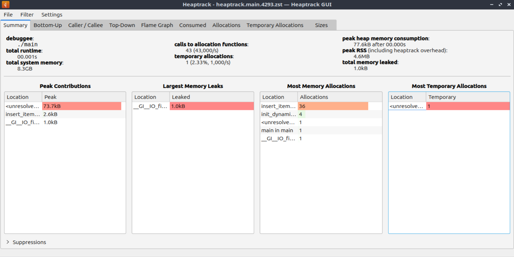

# Introduction
This project is designed to explore the concepts of pointers and memory management. The primary objective is to store user data in memory while ensuring efficient retrieval, updates, and deletion. To achieve optimal performance, I have utilized data structures and algorithms such as linked lists and hashing.

# Memory Management Concepts
A custom type named dynamic_array has been implemented as a struct to manage a collection of elements. This structure supports dynamic resizing through the resize_dynamic_array function and ensures proper memory cleanup via the remove_dynamic_array function.

# User Handling and Optimization 
The system supports basic CRUD operations (Create, Read, Update, Delete) for user management. To optimize the time complexity of these operations, a hashing mechanism was employed. The MurmurHash algorithm was utilized to achieve a uniform distribution of users within the array, minimizing clustering. Further details regarding the MurmurHash algorithm can be found 
on [Medium](https://medium.com/@thealonemusk/murmurhash-the-scrappy-algorithm-that-secretly-powers-half-the-internet-2d3f79b4509b). To resolve collisions, the separate chaining method was implemented.

# Performance Analysis and Validation
To ensure memory efficiency and the absence of leaks, Heaptrack was employed for memory profiling. The testing procedure, implemented in main.c, involved the creation of 20 user records, followed by the update of a single record and the deletion of three others. To verify proper memory management, the remove_dynamic_array function was called to release all allocated resources. The resulting Heaptrack summary is provided below:

# Conclusion
The primary objective of this project was to explore and challenge my knowledge of memory management, pointers, and Data Structures and Algorithms (DSA), rather than building a production-ready database. Consequently, there is significant room for optimization, including the removal of redundant struct fields and the implementation of more efficient algorithms and coding best practices. Thank you for your time and for reading this article.